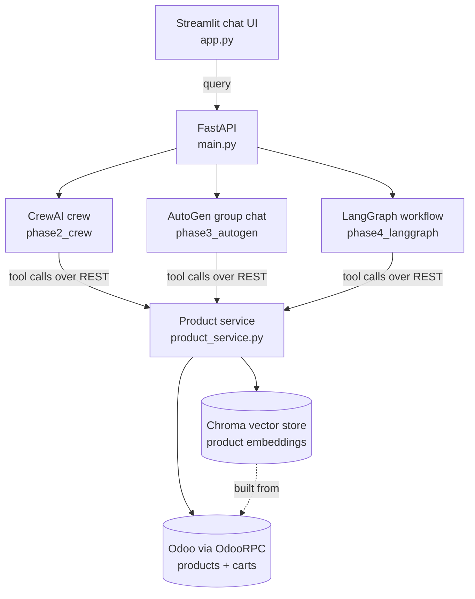

# ShopBuddy-AI
# ShopBuddy-AI

An AI shopping assistant that searches a product catalog with natural language and manages a real shopping cart, built **four ways** (Langflow, CrewAI, AutoGen, LangGraph) on top of the same Odoo backend so the frameworks can be compared side by side.

Ask things like *"show me office chairs under 200"*, *"add 2 of the cheapest one to my cart"*, or *"what's in my cart?"* and the agents search the catalog, resolve the exact product, update the cart in Odoo, and confirm the final cart state.

---

## Features

- **Semantic product search**: Odoo products are embedded with OpenAI `text-embedding-3-small` and stored in Chroma, so "wooden desk" finds relevant items even without an exact name match. Supports min/max price filters, relevance scoring, and de-duplication.
- **Live cart management**: add, update, remove, and view items. Carts are real `sale.order` records in Odoo, not a mock.
- **Multi-agent workflow**: an Orchestrator classifies the request, a Search agent finds products, and a Cart agent performs the change.
- **Safe cart edits**: the agents resolve the user's wording to one exact catalog name before touching the cart, then re-read the cart after every change so the final answer reflects the real state.
- **Framework comparison**: switch between CrewAI, AutoGen, and LangGraph from the UI to compare behavior on the same request.

## Architecture



All three agent frameworks use the **same tools** (search, get cart, add, update, delete) exposed as REST endpoints, so the only variable is how each framework orchestrates the agents.

## The four phases

| Phase | Framework | How it works |
|---|---|---|
| 1 | **Langflow** | Visual flow: Chat Input → Orchestration / Product Search / Cart agents with 5 tools → Chat Output (`phase1_langflow/Shop_Buddy.json`) |
| 2 | **CrewAI** | Three agents (Orchestrator, Search, Cart) run as sequential tasks, passing context between them |
| 3 | **AutoGen** | Group chat with a manager choosing speakers; agents end the conversation with a `TERMINATE` signal |
| 4 | **LangGraph** | Stateful graph: orchestrator classifies intent (`search` or `cart`), routes to a tool-calling agent loop, and keeps conversation memory with a checkpointer |

## Tech stack

Python · FastAPI · Streamlit · CrewAI · AutoGen · LangGraph · LangChain · Langflow · OpenAI (GPT-4o-mini, text-embedding-3-small) · Chroma · Odoo (OdooRPC)

## Project structure

```
.
├── app.py                      # Streamlit chat UI (engine switcher)
├── main.py                     # FastAPI app: product, cart, and chat endpoints
├── product_service.py          # Search + cart logic
├── clients/odoo_client.py      # Odoo RPC connection
├── models/odoo_models.py       # Odoo model helpers
├── vector_store/               # Chroma index built from Odoo products
├── phase1_langflow/            # Exported Langflow flow
├── phase2_crew/                # CrewAI agents and tasks
├── phase3_autogen/             # AutoGen agents and group chat
├── phase4_langgraph/           # LangGraph state graph
└── requirements.txt
```

## Getting started

### Prerequisites

- Python 3.10+
- An Odoo instance with the **Website/eCommerce** and **Sales** apps and some products (carts are Odoo website orders)
- An OpenAI-compatible API key

### 1. Install

```bash
git clone https://github.com/gaurav-porwal/ShopBuddy-AI.git
cd ShopBuddy-AI
python -m venv .venv
source .venv/bin/activate        # Windows: .venv\Scripts\activate
pip install -r requirements.txt
```

### 2. Configure environment

Create a `.env` file in the project root (it is git-ignored):

```env
OPENAI_API_KEY=your-key
OPENAI_BASE_URL=https://api.openai.com/v1

ODOO_ENDPOINT=https://your-odoo-host
ODOO_DB_NAME=your-db
ODOO_ADMIN_USERNAME=your-user
ODOO_ADMIN_PASSWORD=your-password
```

### 3. Run the API

```bash
uvicorn main:app --reload --port 8000
```

### 4. Run the UI

```bash
streamlit run app.py
```

Open the Streamlit URL, pick an engine (CrewAI, AutoGen, or LangGraph) in the sidebar, and start chatting.

### Phase 1 (Langflow)

Run Langflow, import `phase1_langflow/Shop_Buddy.json`, and set your OpenAI key on each of the three agent nodes (use a Langflow global variable rather than pasting the key). The FastAPI server must be running because the flow's tools call its endpoints.

## API endpoints

| Method | Endpoint | Purpose |
|---|---|---|
| GET | `/search_products/?text=&min_price=&max_price=` | Semantic product search |
| GET | `/get_cart_items/` | View current cart |
| POST | `/add_product_to_cart/` | Add a product (`product_name`, `quantity`) |
| PUT | `/update_product_in_cart/` | Change quantity |
| DELETE | `/delete_product_from_cart/` | Remove a product |
| POST | `/crew_chat/` | Chat via CrewAI |
| POST | `/autogen_chat/` | Chat via AutoGen |
| POST | `/langgraph_chat/` | Chat via LangGraph |

Interactive docs are available at `http://localhost:8000/docs`.

## Example prompts

- "Show me office chairs under 150"
- "Add 2 office chairs to my cart"
- "Change the chairs to 4"
- "What's in my cart?"
- "Remove the desk from my cart"

## Roadmap

- Build the vector index once and persist it, instead of re-embedding the catalog on each search
- Per-user carts and sessions with authentication (currently a single Odoo account is used)
- Per-session conversation memory for all three frameworks
- Automated tests for search and cart operations
- Evaluation harness to compare the frameworks on accuracy, latency, and cost
